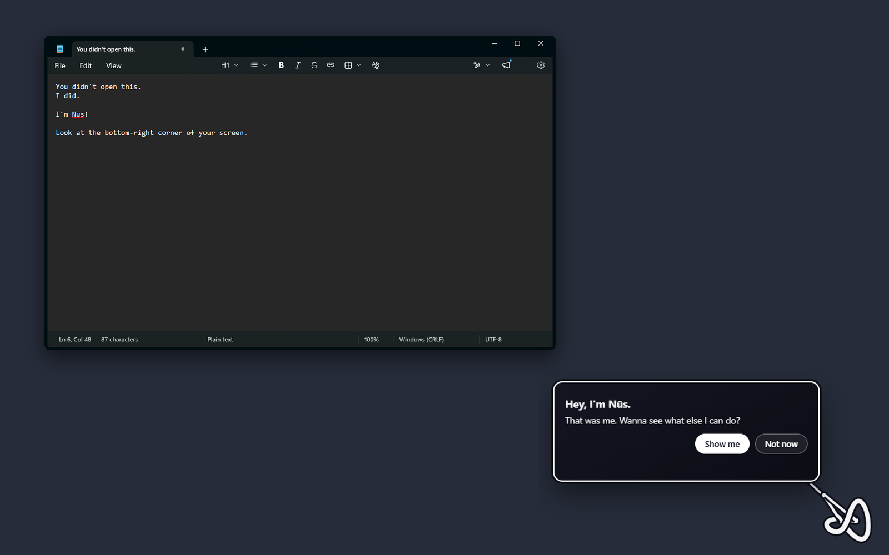

# Nūs Companion

Ask about your screen by voice or text. The Knot points, guides and can act.



The first time you start it, Nūs opens Notepad, types this, and the Knot says
hello from the corner of your screen.

The Nūs Companion is a Windows app (Electron). The Knot sits on your screen.
Hold Ctrl+Alt and ask about what you see, and it answers, points at the right
place, walks you through it step by step, or does it for you with Hands.

## Get it

Download the installer from the
[latest release](https://github.com/potlakai/nus-companion/releases/latest),
from https://publikhq.com/nus, or from https://potlakai.github.io/nus.
Windows 10 and 11, x64. The installer is not code-signed yet, so Windows
SmartScreen may ask you to confirm.

## Who answers

You pick:
- your own key (a free Gemini key, or Anthropic, OpenAI or Nvidia), or
  Claude Code if it is installed and signed in, or
- publik API, after Sign in with publik (from 0.1.18).

When you ask, your question and a picture of your screen go to the AI you
picked. Speech to text, text to speech and search over your own notes run on
this computer.

## What Nūs collects

Anonymous usage stats (an install id, the version, which features are used,
no content). You can turn them off in Settings.

## Build from source

```
npm install
npm run setup:voice
npm run setup:embed
npm run start:companion
```

`npm run dist:companion` builds the Windows installer. It needs the whisper.cpp
binaries in `vendor/whisper` (from `npm run setup:voice`) and the icons in
`build/`, which are not in this repo yet.

## Licence

Apache-2.0 for the code in this repo. "Nūs" and the Knot are trademarks of
Pranav Desu. Third-party parts are listed in `THIRD-PARTY.md`.
